# Mossgrove for Flutter: an NthCase sample app

Mossgrove is a small, fictional shop for home and desk goods. It is built to be tested with
[NthCase](https://nthcase.com), the AI testing platform that records and replays tests on Android, iOS and the web.
Clone it, build it, and run your first NthCase test on it in minutes.

It is one of five identical Mossgrove apps. The same screens, test ids, texts and scenarios are built in Kotlin +
Jetpack Compose, SwiftUI, Flutter (this one), React Native and Ionic, all from one spec: [SPEC.md](SPEC.md),
**spec 1.0**. Every verb NthCase supports has a place to land, and so do the hard cases real apps have: a slow screen,
a failed load with retry, a web view, a system permission prompt, a modal, and a screen with no test ids at all.

- One Flutter app for **Android and iOS**, with the id `com.nthcase.sample` on both.
- No network, no analytics, no ads, no tracking, no third-party packages: only Flutter's own. Everything is seeded
  inside the app, so every run is the same.

| Sign in | Shop | Item | Cart |
| --- | --- | --- | --- |
| 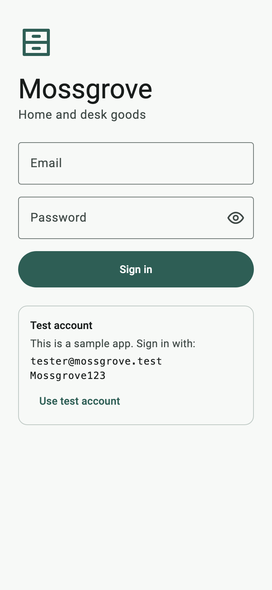 | 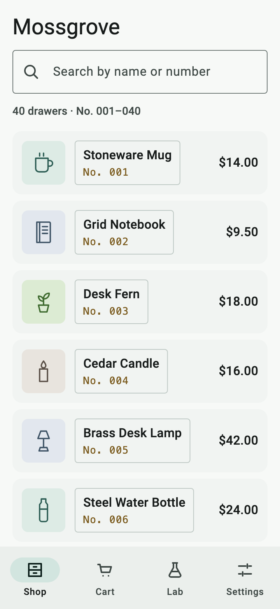 | 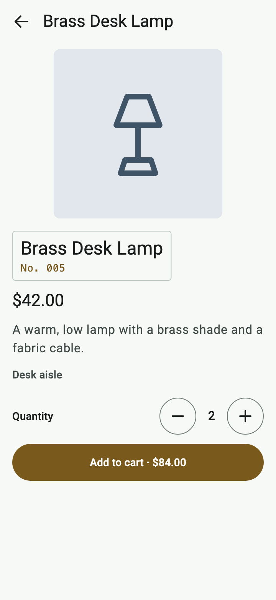 | 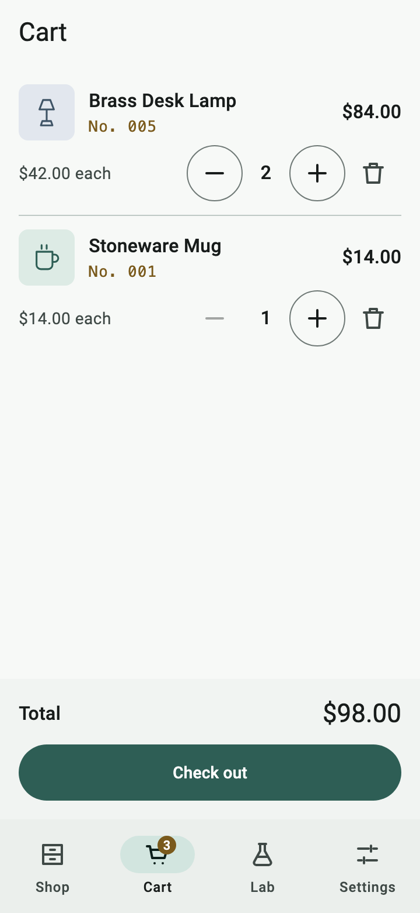 |
| Modal | Lab | Form errors | Form done |
| 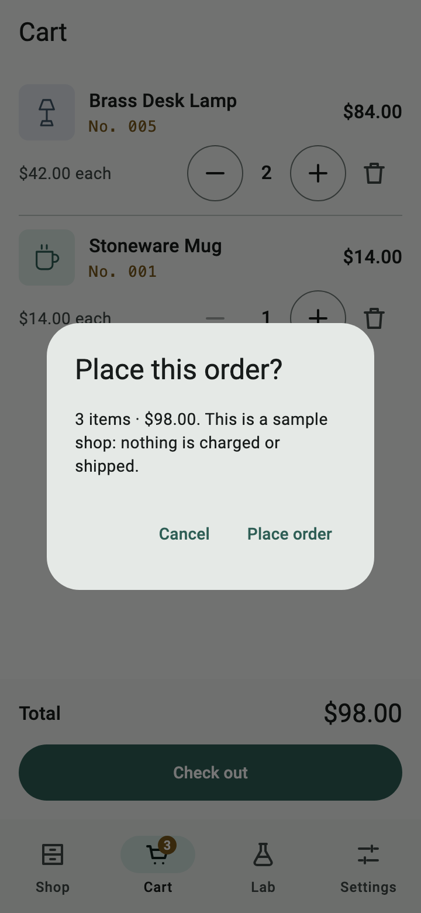 | 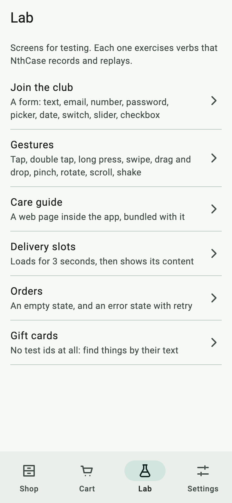 | 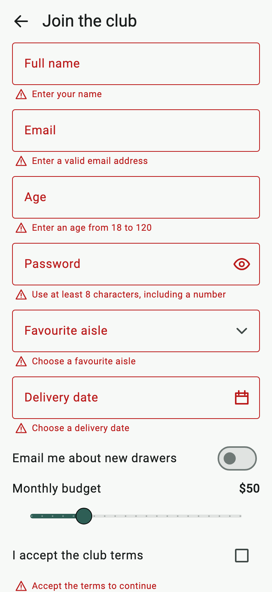 | 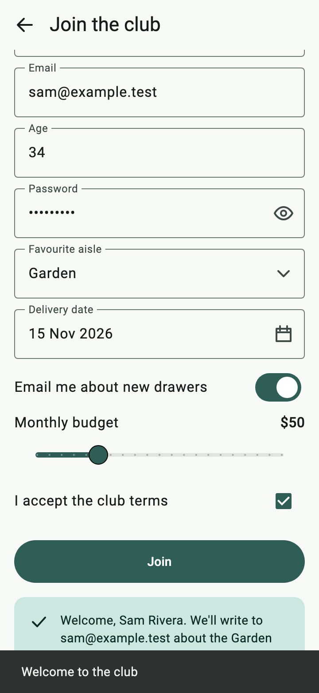 |
| Gestures | Delivery slots | Error + retry | No test ids |
| 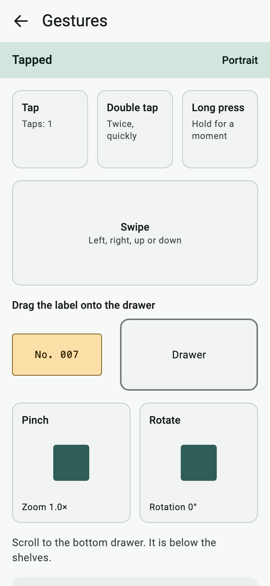 | 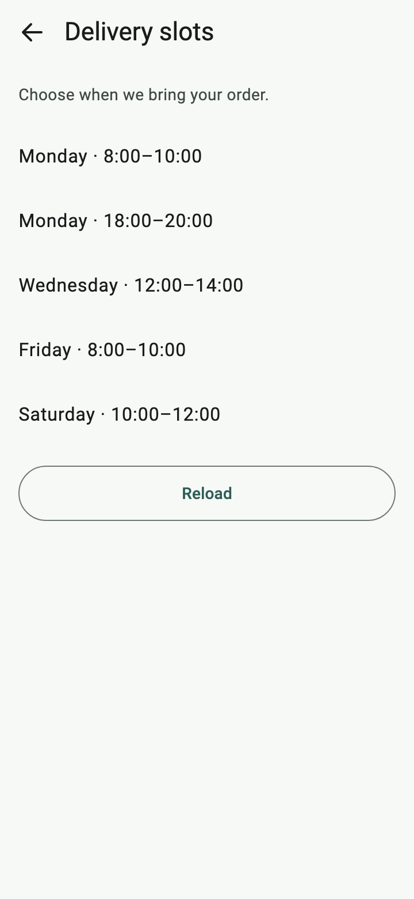 | 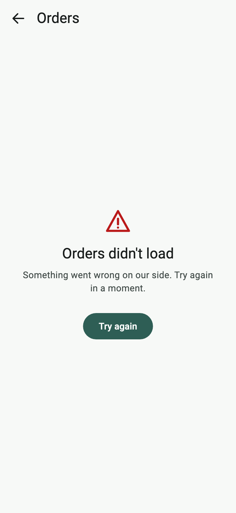 | 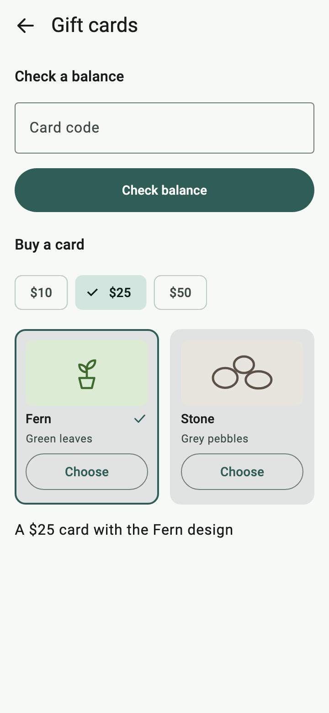 |
| Settings | Settings dialog | Empty search | Deep link, unknown id |
| 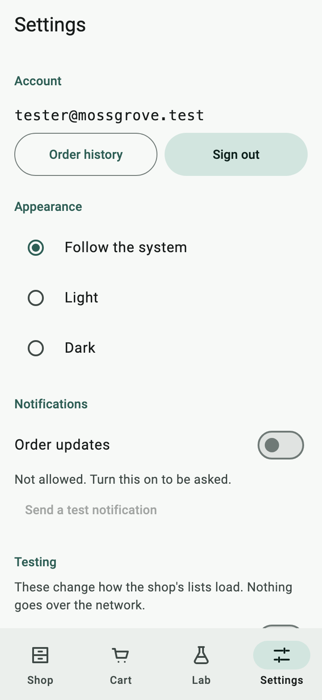 | 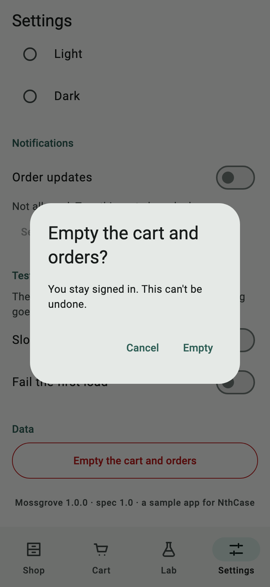 | 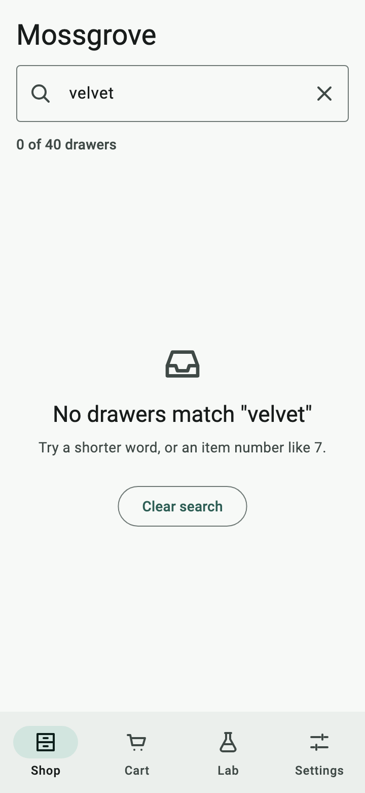 | 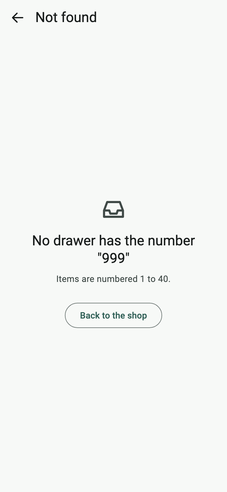 |

All 24 screens, light and dark, are in [docs/screenshots](docs/screenshots). They are the golden files of
`test/goldens_test.dart`, drawn on the host by Flutter's test renderer with Roboto, not on a device. Two things no
golden can show: the care guide's page (host tests have no web engine, so screen 15 shows the native status line over
an empty view) and the system's notification prompt (the OS draws it).

## Test account

| | |
| --- | --- |
| Email | `tester@mossgrove.test` |
| Password | `Mossgrove123` |
| Gift-card code | `MOSS-0025` |
| Deep link | `nthcase-sample://item/{1–40}` |
| Android application id, iOS bundle id | `com.nthcase.sample` |

The account is printed on the sign-in screen too, with a **Use test account** button.

## Build

You need **Flutter 3.47.9** (stable, Dart 3.13), the Android SDK with JDK 17 or newer, and, for iOS, Xcode 26. Every
[release](../../releases) also has ready-built apps.

```bash
flutter build apk --debug
```

The APK is `build/app/outputs/flutter-apk/app-debug.apk`: debug-signed, for arm64, armeabi-v7a and x86_64. It runs on
its own; a Flutter debug build carries its Dart code inside, so no development server is involved.

```bash
flutter build ios --simulator --debug --no-codesign
```

That builds `build/ios/iphonesimulator/Runner.app` for your Mac's simulator. CI builds the one it ships for both
simulator architectures (arm64 and x86_64) with `xcodebuild … ARCHS="arm64 x86_64"`; see
[.github/workflows/build.yml](.github/workflows/build.yml). Install it with `xcrun simctl install <udid> Runner.app`.

| | |
| --- | --- |
| Framework | Flutter 3.47.9, Dart 3.13, Material 3 (dynamic colour off) |
| Android | minSdk 26 (Android 8.0), targetSdk and compileSdk 37 (Android 17); Gradle 9.3.1 and AGP 9.1 from Flutter's template |
| iOS | iOS 17 and newer; Flutter's plugins through Swift Package Manager (no CocoaPods) |
| Permissions | Android: `POST_NOTIFICATIONS` only. **No `INTERNET`**, not even in debug builds. iOS: notifications, asked at runtime |

**Hot reload.** Flutter's template asks for `INTERNET` in debug builds so `flutter run` can reach the app's Dart VM
service. Mossgrove ships its debug build to test with and the spec allows it no network, so the permission is left
out: `flutter run` on Android installs and starts the app but cannot attach. To develop with hot reload, add
`<uses-permission android:name="android.permission.INTERNET"/>` to `android/app/src/debug/AndroidManifest.xml` on your
machine, and do not commit it. iOS has no such permission; `flutter run` works there as usual.

## Tests

```bash
flutter test
```

Everything runs on the host: no emulator, no simulator.

| File | What it proves |
| --- | --- |
| `test/data_test.dart` | the catalogue is SPEC.md §3 row for row; search, cart, orders, form rules, the shake detector, swipe directions, deep-link parsing, the SVG path reader, the art against `art/`, the version, and every fixed text of SPEC.md §6 in the app's source |
| `test/flows_test.dart` | scenarios 01–10 played as widget tests, read from the semantics tree; the tab-reset rule; sign out |
| `test/ids_test.dart` | **the id census**: every id in `nthcase/test-ids.json` on its screen, in the state the spec names, as a node of its own in the tree the engine sends to Android and iOS, on the control itself (a text field's id on the text field, a button's on the button); Gift cards has none |
| `test/deep_link_test.dart` | the deep link through Flutter's own navigation channel: cold start, while running, unknown ids, other hosts ignored |
| `test/goldens_test.dart` | every screen, light and dark, at 360 × 780 (macOS only; `--tags golden`) |

```bash
flutter test --tags golden                  # compare the screenshots (macOS)
flutter test --update-goldens --tags golden # redraw them
```

CI also runs the app on an Android emulator and an iOS simulator, and reads each screen's ids from the trees Appium
reads: UiAutomator's (`tool/android_ids_check.py`) and XCUITest's (`ios/RunnerUITests/IdsUITests.swift`).

## Test it with NthCase

1. Install the app on an emulator, a test phone or a simulator: `adb install app-debug.apk`, or
   `xcrun simctl install <udid> Mossgrove.app`.
2. Connect the device to NthCase with the agent: `npx nthcase-agent@latest`. The NthCase docs, under *Your
   devices*, walk through it. Or use a cloud device.
3. In NthCase, add an app with the id `com.nthcase.sample`, and upload the APK or the zipped simulator app as its build.
4. Create a scenario from one of the files in [nthcase/scenarios](nthcase/scenarios): its numbered lines are the
   steps, and each `Expect:` line is that step's check. Or record one: **Scenarios → New scenario → Record**.
5. Compile it, and run it.

With NthCase's MCP server, ask your assistant to "create a scenario from nthcase/scenarios/03-cart-and-order.md for
Mossgrove and run it on my Android phone".

## What it covers

| NthCase verb | Where | Scenario |
| --- | --- | --- |
| launch, tap, type | sign in, search, every button | 01, 02 |
| scroll to an element, swipe | the 40-item list; the form; the gestures screen | 02, 04, 05 |
| doubletap, longpress, pinch, dragdrop | Lab › Gestures | 05 |
| slide, select | Lab › Join the club (slider, dropdown, date picker) | 04 |
| rotate, lock, unlock, home, back | any screen | 06 |
| a web view | Lab › Care guide (a bundled page) | 07 |
| waitFor, an error with retry, empty states | Lab › Delivery slots, Lab › Orders, Settings › Testing | 08 |
| a system permission prompt, a modal | Settings | 09 |
| a screen with no test ids | Lab › Gift cards | 10 |
| extract, startif / endif | the cart total; sign in only if asked | 03, 06 |
| deep link | `nthcase-sample://item/7` | 11 |

The full table, with every check type and the known gaps, is in [SPEC.md §8](SPEC.md#8-verb-coverage).

## Test ids

Every control has a stable test id from one list shared by all five apps: [nthcase/test-ids.json](nthcase/test-ids.json).
In Flutter each one is `Semantics(identifier: 'shop_search')` (Flutter 3.19 and newer). The engine hands it to
Android as the node's `resource-id` (`resource-id="shop_search"`, no package prefix) and to iOS as its
`accessibilityIdentifier` (Appium's `name`). A `Key` is for Flutter's own tests and is **not** seen by Appium.

Two Flutter facts worth knowing when you write a check:

- **Each id is its own node, on the control itself.** Flutter folds the texts inside a node into its label, and a
  button, a slider or a navigation tab is a node of its own. So a field's id sits on the text field, a button's on
  the button (`MergeSemantics` joins the two), and the form's error lines are separate nodes under their fields. The
  tests check this in the tree the engine sends.
- **On Android, a label is `content-desc`.** Flutter writes a node's label (and value) to `content-desc`; only text
  fields have `text`. On iOS it is the element's `label` and `value`. The value ids (`item_qty_value`,
  `form_budget_value`, …) hold the value alone, so a check reads exactly "2" or "$120".

The app also keeps Flutter's semantics tree on from its first frame (`SemanticsBinding.ensureSemantics()`), so a
tool's first look at a screen finds the ids without waiting for an accessibility service to ask for them. The
care-guide page's elements have the same HTML `id` and `data-testid`; debug builds let Appium switch into its WEBVIEW
context. The Gift cards screen has no ids, on purpose.

## Flutter-specific notes

- **Settings** is built with plain Material widgets, like every other screen. The native apps build it with their
  platform's classic toolkit (XML Views, UIKit); Flutter has no second toolkit, as SPEC.md §12 says.
- **Shake** and the **notification permission** go through platform channels of the app's own, because their usual
  packages are third-party: `MainActivity.kt` streams the accelerometer (`SensorManager`) and asks for
  `POST_NOTIFICATIONS` through the Activity; `AppDelegate.swift` reports UIKit's `motionEnded` shake and uses
  `UNUserNotificationCenter`. The channels are `com.nthcase.sample/motion` and `com.nthcase.sample/notifications`.
- **The deep link** is Flutter's own deep linking (`flutter_deeplinking_enabled`, `FlutterDeepLinkingEnabled`): the
  engine passes the whole URI to the app's Router, which opens `nthcase-sample://item/{id}` and ignores anything else.
- **Art:** `tool/convert_art.dart` turns `art/*.svg` into the Dart path data the app draws and the Android launcher and
  notification icons; `tool/app_icon_test.dart` draws the iOS app icon. `art/` itself is unchanged. No icon font is
  bundled (`uses-material-design: false`).

## Packages

Runtime: Flutter's own only, every one published by **flutter.dev** or **dart.dev** on pub.dev, except one that
comes with the Flutter SDK itself.

| Package | Publisher | Why |
| --- | --- | --- |
| `flutter` (SDK) | flutter.dev | the framework |
| `webview_flutter` | flutter.dev | the care guide's web view |
| `webview_flutter_android`, `webview_flutter_wkwebview` | flutter.dev | its Android and iOS halves; named directly for their debug-inspection switches |
| `webview_flutter_platform_interface`, `plugin_platform_interface` | flutter.dev | brought in by `webview_flutter` |
| `vector_math` | flutter.dev | brought in by the Flutter SDK |
| `characters`, `collection`, `meta`, `path` | dart.dev | brought in by the Flutter SDK and `webview_flutter_wkwebview` |
| `material_color_utilities` | material.io | brought in by the Flutter SDK itself, which pins it; Mossgrove does not use it directly |

Test and build only, never in the app: `flutter_test` (the SDK), `flutter_lints` (flutter.dev), and what they bring
in, published by dart.dev and tools.dart.dev (`lints`, `matcher`, `test_api`, `fake_async`, `leak_tracker`, …). CI
uses GitHub's own actions and `reactivecircus/android-emulator-runner` for the emulator job, all pinned by commit.

## Layout

```
lib/main.dart                 starts the app
lib/src/data/                 catalogue, cart, app state, form rules, shake detector, deep link
lib/src/ui/                   the app and its Router, components, theme, art (+ art_data.g.dart, generated)
lib/src/ui/screens/           sign in, shop, item, cart, lab, form, gestures, web view, slow, orders, gift cards, settings
lib/src/platform/device.dart  the two platform channels, and a fake for the tests
lib/src/ids.dart              every test id
android/                      MainActivity.kt (channels), the manifest (deep link, no INTERNET)
ios/                          AppDelegate.swift (channels, shake), Info.plist (URL scheme), RunnerUITests
assets/web/care-guide.html    the web view's page
test/                         unit, flow, id-census, deep-link and golden tests
tool/                         the art converter, the iOS icon, the Android id check CI runs
art/  nthcase/  SPEC.md       the shared sources, unchanged
docs/screenshots/             every screen, light and dark
```

## Licence

Apache-2.0, see [LICENSE](LICENSE) and [NOTICE](NOTICE). Mossgrove, its items and its drawings are fictional and were
made for these apps. "NthCase" is a trademark of Unidots Software Solutions LLC.
